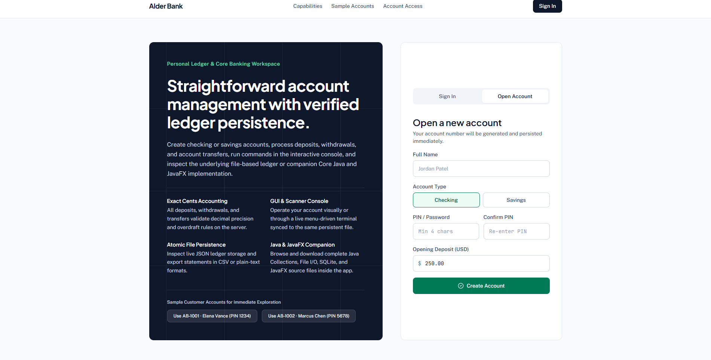
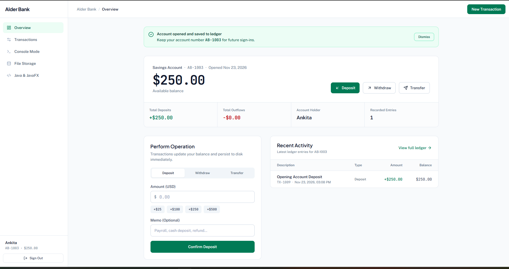

# 🏦 Alder Bank — Banking Application

A modern, interactive banking application designed to simulate essential banking operations through a clean and user-friendly dashboard.

The application allows users to manage their banking accounts, perform transactions, monitor balances, explore transaction history, and interact with banking features through an intuitive interface.

This project is part of my **Vibe Coding – AI-Assisted Development Portfolio**, where I explore modern application development, software architecture, and practical implementation using AI-assisted workflows.

---

## 📸 Application Screenshots

### 1. Banking Dashboard

The main dashboard provides an overview of the user's bank account, available balance, total deposits, transaction activity, and quick access to banking operations.



### 2. Transactions & Account Management

This section showcases transaction management and account-related functionality.




---

## ✨ Key Features

### 🔐 Account Management
- User account creation and login.
- Account information display.
- Account number management.
- Account balance overview.

### 💰 Banking Operations
- Deposit money into an account.
- Withdraw money from an account.
- Transfer funds.
- Real-time balance updates.
- Transaction amount validation.

### 📊 Dashboard & Analytics
- Available account balance.
- Total deposits.
- Total outflows.
- Account holder information.
- Recorded transaction count.
- Recent banking activity.

### 📜 Transaction Management
- Maintain transaction records.
- View transaction history.
- Display transaction types and amounts.
- Track account balances after transactions.
- Add transaction descriptions and optional memos.

### 💾 File Storage & Console Mode
- Dedicated file storage interface.
- Console-based interaction module.
- Java and JavaFX source code exploration panel.

---

## 🛠️ Technology Stack

| Technology | Purpose |
|---|---|
| React.js | Frontend development |
| TypeScript | Type-safe application development |
| Vite | Frontend build tool and development server |
| Node.js | Server-side JavaScript runtime |
| Express.js | Backend server framework, if configured |
| HTML5 | Application structure |
| CSS3 | Styling and responsive interface |
| Java | Java source code exploration |
| JavaFX | Java GUI concepts and source code exploration |

*Note: The committed project structure contains React/TypeScript application files. Java and JavaFX are represented in the application's learning/exploration module; they should not be considered the banking application's implementation backend.*

---

## 🏗️ Application Modules

The application is organized into different functional modules:

| Module | Description |
|---|---|
| Overview | Displays account balance, deposits, outflows, and recent activity. |
| Transactions | Provides access to banking transaction records. |
| Console Mode | Provides a dedicated console interaction interface. |
| File Storage | Explores file storage functionality. |
| Java & JavaFX | Displays Java and JavaFX source code examples. |
| Authentication | Provides the account access interface. |

---

## 📂 Project Structure

```text
banking-application/
│
├── src/
│   ├── components/
│   │   ├── AuthPortal.tsx
│   │   ├── ConsolePanel.tsx
│   │   ├── FileStoragePanel.tsx
│   │   ├── JavaSourcePanel.tsx
│   │   ├── OverviewPanel.tsx
│   │   └── TransactionsPanel.tsx
│   │
│   ├── data/
│   │   └── javaSourceFiles.ts
│   │
│   ├── services/
│   │   └── api.ts
│   │
│   ├── types/
│   │   └── banking.ts
│   │
│   ├── utils/
│   │   └── format.ts
│   │
│   ├── App.tsx
│   ├── index.css
│   └── main.tsx
│
├── docs/
│   └── screenshots/
│       ├── dashboard.png
│       └── transactions.png
│
├── .env.example
├── .gitignore
├── index.html
├── metadata.json
├── package.json
├── server.ts
├── tsconfig.json
├── vite.config.ts
└── README.md
```

---

## 🚀 Getting Started

Follow these steps to run the project locally.

### Prerequisites

Make sure you have installed:

- Node.js
- npm
- Git
- VS Code or another code editor

### 1. Clone the Repository

```bash
git clone https://github.com/ankitakr9/vibe-coding.git
```

### 2. Navigate to the Project Directory

```bash
cd vibe-coding/banking-application
```

### 3. Install Dependencies

```bash
npm install
```

### 4. Configure Environment Variables

Create your `.env` file using the provided example:

```bash
cp .env.example .env
```

Update the environment variables according to your project configuration.

Never commit your actual `.env` file or expose API keys and secrets.

### 5. Run the Application

```bash
npm run dev
```

Open the local URL displayed in your terminal.

*Note: The exact environment variables, server startup command, and available npm scripts depend on the project's configuration in `package.json`.*

---

## 🎓 Learning Outcomes

Through this project, I explored:

- Building interactive user interfaces using React.
- Working with TypeScript and reusable components.
- Understanding banking operations and transaction workflows.
- Managing application state and displaying financial information.
- Organizing frontend code into reusable modules.
- Understanding file storage and console-based application concepts.
- Exploring Java and JavaFX through source code examples.
- Working with modern frontend development tools.

---

## 🤖 AI-Assisted Development

This project was developed as part of my AI-assisted development journey using **Google AI Studio (Gemini)** as a coding assistant.

My development workflow included:

1. Defining project requirements and application functionality.
2. Designing detailed prompts for AI-assisted development.
3. Generating and organizing application components.
4. Reviewing and customizing generated code.
5. Improving the user interface and application experience.
6. Debugging and refining application functionality.
7. Maintaining project documentation and version control.

AI is used as a development assistant while understanding and exploring the generated implementation remains an important part of my learning process.

---

## 🔮 Future Enhancements

- Implement enhanced authentication and authorization.
- Introduce persistent database storage.
- Improve transaction security and validation.
- Add detailed transaction filtering and search.
- Implement account statements and downloadable reports.
- Improve dashboard analytics.
- Add automated testing.

---

## 👩‍💻 Author

**Ankita Kumari**

Aspiring Java Full Stack Developer | Exploring Full-Stack Development | AI-Assisted Development Enthusiast

- GitHub: [@ankitakr9](https://github.com/ankitakr9)
- Project Collection: [Vibe Coding](https://github.com/ankitakr9/vibe-coding)

---

## ⭐ Support

If you find this project interesting, consider giving this repository a ⭐.

**Learn. Build. Experiment. Repeat. 🚀**