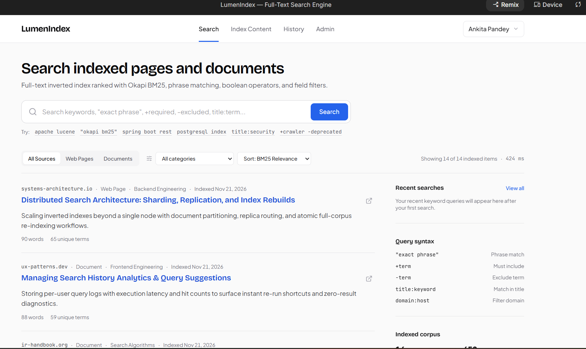

# 🔎 LumenIndex — Full-Text Search Engine

A full-stack search engine application designed to index, organize, and retrieve web pages and documents efficiently using **Apache Lucene** and its powerful full-text search capabilities.

LumenIndex provides a centralized search interface with relevance-ranked results, phrase matching, Boolean operators, search history, and content management.

## 📸 Project Preview



## 🌐 Overview

LumenIndex is a full-stack search engine application built to demonstrate how modern search systems index and retrieve information.

The application uses Apache Lucene for full-text indexing and search operations, with Okapi BM25 relevance scoring to rank search results based on their relevance to user queries.

It provides an intuitive interface where users can search indexed web pages and documents, explore search results, and manage indexed content.

## ✨ Key Features

### 🔍 Advanced Search
- Full-text search across indexed pages and documents.
- Relevance-based result ranking using Okapi BM25.
- Exact phrase matching.
- Boolean search operators.
- Required and excluded keyword support.
- Field-specific search filters.
- Domain-based filtering.

### 📚 Content Indexing
- Index web pages and documents.
- Organize indexed content by category.
- Manage searchable content.
- Maintain an indexed content collection.

### 📊 Search History
- Maintain a history of previous searches.
- Track search queries.
- Display recent search activity.
- Quickly revisit previous searches.

### 🛡️ Admin Dashboard
- Dedicated administration interface.
- Manage indexed content.
- Organize and monitor search data.

### 🎯 Search Result Management
- Filter results by source type.
- Sort results by BM25 relevance.
- Display indexed document information.
- Show matching content and search execution time.

## 🛠️ Technology Stack

| Technology | Purpose |
|---|---|
| Java | Backend programming |
| Spring Boot | Backend application framework |
| Spring Security | Application security |
| Spring Data JPA / Hibernate | Database interaction |
| MySQL | Relational database |
| Apache Lucene | Full-text indexing and search |
| Okapi BM25 | Search relevance ranking |
| Thymeleaf | Server-side frontend rendering |
| HTML5 | Page structure |
| CSS3 | Styling and responsive layouts |
| JavaScript | Frontend interactions |
| Maven | Dependency management |

## 🧠 Search Query Syntax

LumenIndex supports different search operators to make searching more flexible.

| Syntax | Description | Example |
|---|---|---|
| `"phrase"` | Exact phrase matching | `"okapi bm25"` |
| `+term` | Term must be included | `+crawler` |
| `-term` | Exclude a term | `-deprecated` |
| `title:keyword` | Search within titles | `title:security` |
| `domain:host` | Filter by domain | `domain:apache.org` |

**Example Queries:**

- `apache lucene`
- `"okapi bm25"`
- `spring boot rest`
- `postgresql index`
- `title:security +crawler -deprecated`

## ⚙️ How It Works

1. **Content Collection:** Web pages and documents are added to the application.
2. **Indexing:** Apache Lucene processes the content and creates searchable indexes.
3. **Query Processing:** User search queries are processed using supported search syntax.
4. **Search Execution:** Lucene retrieves matching indexed documents.
5. **Relevance Ranking:** Okapi BM25 ranks the matching results.
6. **Result Display:** Relevant results are displayed through the search interface.

## 📂 Project Modules

- **Search:** Search indexed pages and documents.
- **Index Content:** Manage content available in the search index.
- **History:** View previous search activity.
- **Admin:** Manage application content and administrative operations.

## 🚀 Getting Started

### Prerequisites

Make sure you have installed:

- Java JDK 17 or later (depending on project configuration).
- Maven.
- MySQL Server.
- IntelliJ IDEA or Eclipse.
- Git.

### Installation

**1. Clone the repository**

```bash
git clone YOUR_GITHUB_REPOSITORY_URL
```

**2. Navigate to the project directory**

```bash
cd LumenIndex
```

**3. Configure MySQL**

Create a database in MySQL and update the database configuration in your application properties.

```properties
spring.datasource.url=jdbc:mysql://localhost:3306/lumenindex
spring.datasource.username=YOUR_USERNAME
spring.datasource.password=YOUR_PASSWORD
```

**4. Build the application**

```bash
mvn clean install
```

**5. Run the application**

```bash
mvn spring-boot:run
```

**6. Open the application**

```text
http://localhost:8080
```

*Note: Adjust the Java version, database settings, and application URL according to your actual project configuration.*

## 🎓 Learning Outcomes

Through this project, I explored and practiced:

- Building backend applications using Java and Spring Boot.
- Implementing full-text search using Apache Lucene.
- Understanding inverted indexing concepts.
- Applying Okapi BM25 for relevance-based ranking.
- Working with search queries and Boolean operators.
- Managing relational data using MySQL and Hibernate.
- Developing web interfaces using Thymeleaf.
- Understanding the fundamentals of search engine architecture.

## 🤖 AI-Assisted Development

LumenIndex was developed as part of my AI-assisted development and Vibe Coding journey.

AI tools were used as development assistants to accelerate implementation, explore technical concepts, improve application structure, and build the user interface.

The project also provided an opportunity to explore backend engineering concepts and understand how search engines work internally.

## 🔮 Future Enhancements

- Support additional document formats.
- Implement web crawling and automated content indexing.
- Add pagination for large search result collections.
- Improve search analytics and reporting.
- Optimize indexing and search performance.
- Introduce advanced search filters.

## 👩‍💻 Author

**Ankita Kumari**

Java Full Stack Developer | MCA Graduate | Aspiring Software Engineer

- GitHub: [@ankitakr9](https://github.com/ankitakr9)
- Portfolio: [GitHub Projects](https://github.com/ankitakr9/vibe-coding)

---

⭐ If you find this project interesting, consider giving it a star!
